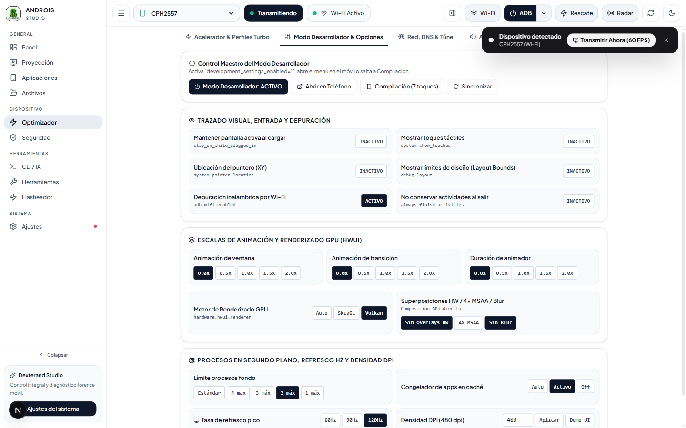
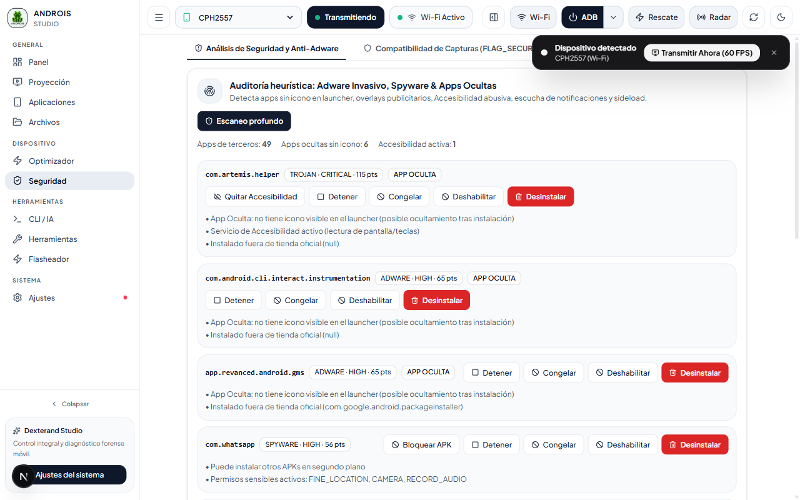
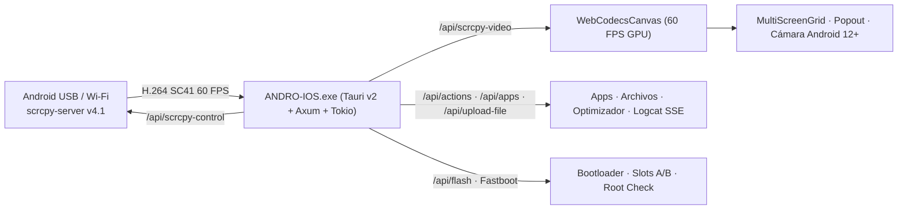

  
  <h1>ANDRO-IOS</h1>
  
<strong>Suite de Proyección 60 FPS, Multi-Pantalla Android/iOS, Telemetría en Vivo, Flasheador Fastboot y Auditoría de Apps</strong>

  

    <a href="https://github.com/emmahiguita/AndroProject_Dev/releases/latest/download/Instalador_ANDRO-IOS.exe"><strong>Descargar Instalador Windows (.exe)</strong></a> ·
    <a href="https://github.com/emmahiguita/AndroProject_Dev/releases/latest"><strong>Ver Releases</strong></a> ·
    <a href="./AndroProject_Installer/README.md">Guía del Instalador</a> ·
    <a href="./docs/ARCHITECTURE_MAP.md">Arquitectura</a>
  

> **Instalación rápida en Windows (1 clic):**
> 1. Descarga **[`Instalador_ANDRO-IOS.exe`](https://github.com/emmahiguita/AndroProject_Dev/releases/latest/download/Instalador_ANDRO-IOS.exe)** y ejecútalo (instala en `C:\AndroProject` y crea acceso directo en el Escritorio).
> 2. O desde el repo clonado ejecuta `powershell -ExecutionPolicy Bypass -File .\AndroProject_Installer\build.ps1`.
> 3. **Desinstalación**: ejecuta [uninstall.bat](./AndroProject_Installer/uninstall.bat) o elimina `C:\AndroProject` y el acceso directo `ANDRO-IOS.lnk`.

---

## Demos en Vivo (Reproducción Automática en GitHub)

| Recorrido Completo (Modo Oscuro 2026 + Modo Claro) | Transmisión Real Móvil (`scrcpy 4.1` en Vivo) |
|---|---|
|  |  |
| [Descargar MP4 HD (`androproject-walkthrough.mp4`)](./docs/images/androproject-walkthrough.mp4) | [Descargar MP4 HD (`mobile-transmission-record.mp4`)](./docs/images/mobile-transmission-record.mp4) |

## Code signing policy

Free code signing provided by [SignPath.io](https://about.signpath.io/), certificate by [SignPath Foundation](https://signpath.org/).

- **Team roles**:
  - **Committers & Authors**: [@emmahiguita](https://github.com/emmahiguita)
  - **Reviewers & Approvers**: [@emmahiguita](https://github.com/emmahiguita)
- **Privacy policy**: This program will not transfer any information to other networked systems unless specifically requested by the user or the person installing or operating it. Local device telemetry and screen mirroring operate strictly over the user's own USB/LAN connection.

## Modo Oscuro 2026 vs Modo Claro

| Módulo | Modo Oscuro 2026 | Modo Claro |
|---|---|---|
| **Aplicaciones (407 apps)** |  |  |
| **Optimizador & Modo Desarrollador** |  |  |
| **Seguridad & Capturas** |  |  |
| **Herramientas & Drivers USB** |  |  |
| **Flasheador & Bootloader** |  |  |

## Capturas Reales Actualizadas

### 1. Proyección Multi-Pantalla Concurrente (60 FPS WebCodecs H.264)
Transmisión simultánea de **Samsung Galaxy A30s (`SM-A307G`)** y **OPPO A79 5G (`CPH2557`)** lado a lado con decodificación H.264 por GPU y control táctil de baja latencia (`< 2 ms`):

### 2. Panel Principal y Telemetría en Tiempo Real
Lectura directa del kernel Android (CPU, RAM, temperatura térmica, almacenamiento libre) y acceso rápido a las 407 aplicaciones instaladas:

### 3. Gestor de Arranque, Bootloader, Particiones Fastboot y Sideload
Inspección en vivo de estado ADB/Fastboot, Slot A/B activo, OEM Unlock, VBMeta, detección de Root (`su`/Magisk) y flasheo seguro de particiones `.img` / `.zip`:

---

## Mapa de Arquitectura y Flujos (100% Rust Backend · Cero Node.js / Cero Python)

---

## Explicación de Funciones por Módulo (100% Rust Nativo)

| Módulo | Qué hace | Cómo funciona | Archivo |
|---|---|---|---|
| **Servidor Embebido Rust** | Sirve la UI estática (`www/`, 4.7 MB) y toda la API local en `127.0.0.1:3000` | Axum + Tokio embebido dentro de `ANDRO-IOS.exe` (`0` Node.js, `0` Python, arranque `< 15 ms`) | [mod.rs](./androproject-gui/src-tauri/src/server/mod.rs) · [main.rs](./androproject-gui/src-tauri/src/main.rs) |
| **Hub Scrcpy 4.1 (60 FPS)** | Administra streams H.264 paralelos por serial e inyección táctil binaria `< 1 ms` | Cabecera `80B` (`scrcpy 4.1`), clasificación NAL SPS/IDR y broadcast Tokio zero-overhead | [scrcpy_hub.rs](./androproject-gui/src-tauri/src/server/scrcpy_hub.rs) · [scrcpy_api.rs](./androproject-gui/src-tauri/src/server/scrcpy_api.rs) |
| **Player GPU WebCodecs** | Decodifica H.264 hardware a 60 FPS | Lee `avc1.PPCCLL` del SPS y dibuja en `<canvas desynchronized>` | [webcodecs-h264-player.ts](./androproject-gui/src/lib/services/webcodecs-h264-player.ts) |
| **Telemetría Kernel Real** | Lee CPU, RAM, almacenamiento, batería, temperatura y VBMeta | Lote único `adb shell` con `CREATE_NO_WINDOW` | [telemetry.rs](./androproject-gui/src-tauri/src/server/telemetry.rs) · [device_api.rs](./androproject-gui/src-tauri/src/server/device_api.rs) |
| **Cámara Universal Android 12+ & VisionNano** | Configura cámara de cualquier celular (lente trasera/frontal/externa, resolución, FPS, linterna) y pantalla externa sin CMD | Flags `--video-source=camera`, `--camera-facing`, `--camera-size`, `--camera-torch`, `--list-cameras` + `Subsystem 2 GUI` | [extra_actions.rs](./androproject-gui/src-tauri/src/server/extra_actions.rs) · [VisionNanoStudioCard.tsx](./androproject-gui/src/components/projection/VisionNanoStudioCard.tsx) |
| **Apps, Archivos & Logcat SSE** | Lista/desinstala apps, explora `/sdcard`, instala APK y transmite Logcat en vivo | `POST /api/apps`, `GET/POST /api/upload-file`, `GET /api/logcat` SSE nativo en Rust | [apps_api.rs](./androproject-gui/src-tauri/src/server/apps_api.rs) · [system_api.rs](./androproject-gui/src-tauri/src/server/system_api.rs) |
| **Flasheador & Seguridad** | Inspecciona Bootloader/ADB/Fastboot, escaneo heurístico anti-spyware y comandos seguros | `POST /api/flash` (multipart), `GET /api/security-scan` y filtro anti-`rm -rf /` (`403`) | [actions_api.rs](./androproject-gui/src-tauri/src/server/actions_api.rs) · [FlasherView.tsx](./androproject-gui/src/features/FlasherView.tsx) |

---

## Documentación Completa

- [Mapa Técnico Detallado](./docs/ARCHITECTURE_MAP.md)
- [Instrucciones de Uso](./INSTRUCCIONES-USO.md)
- [Integración Kali / Termux](./scripts/kali/README-KALI-TERMUX.md)
- [Instalador Oficial Windows](./AndroProject_Installer/README.md)

## Demos en Video (Transmisión Móvil & Suite Dark/Light)

- [Grabación Real de Transmisión Móvil (scrcpy 4.1)](./docs/images/mobile-transmission-record.mp4)
- [Recorrido Completo Modo Oscuro y Modo Claro](./docs/images/androproject-walkthrough.mp4)
