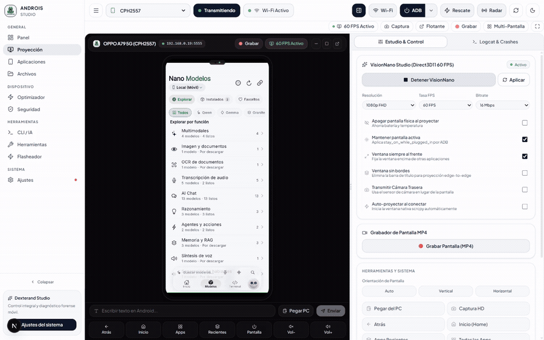
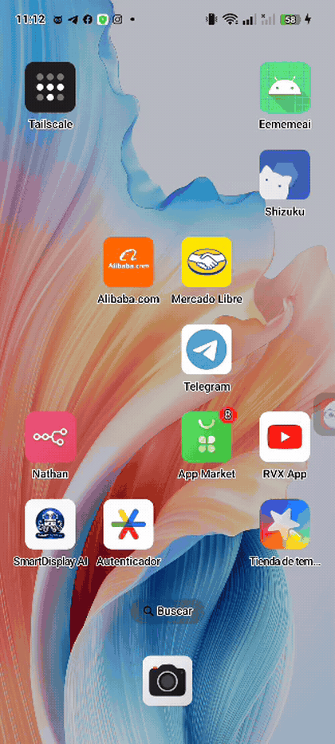
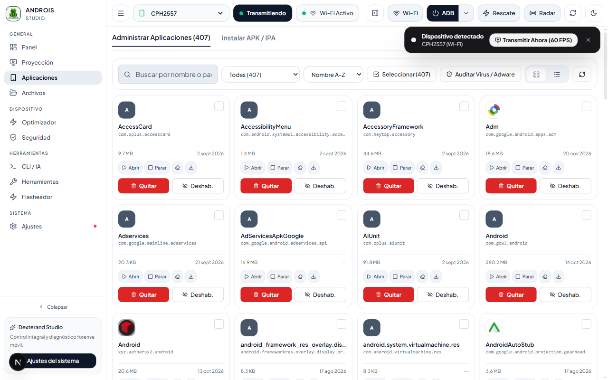
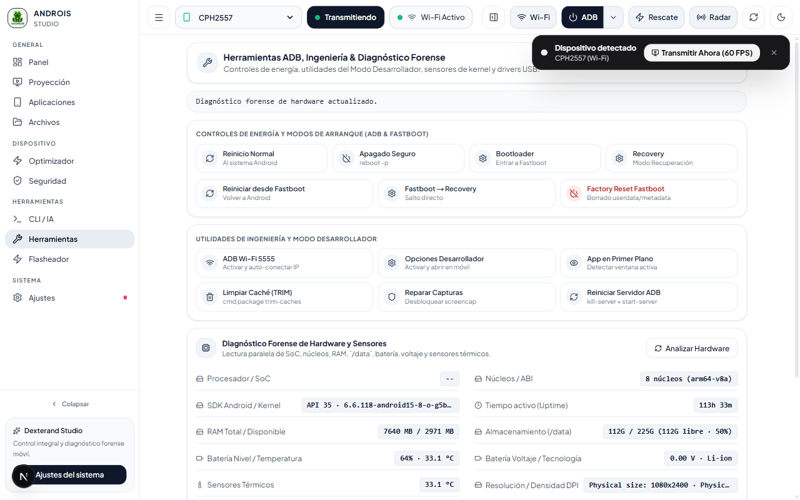
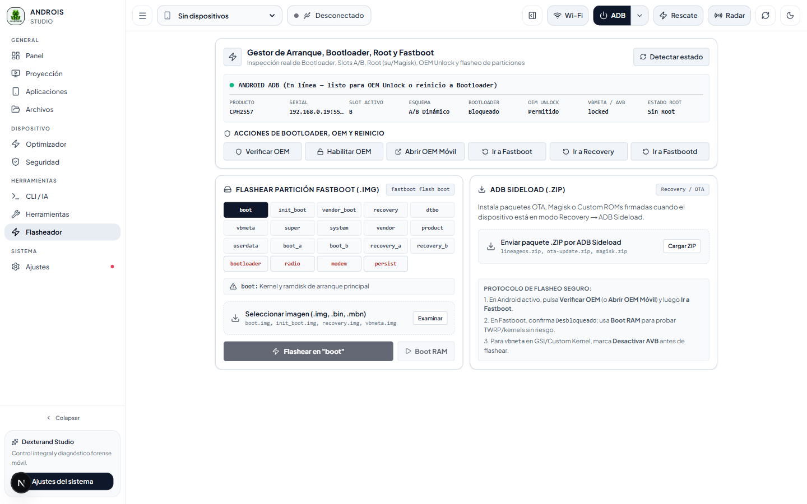
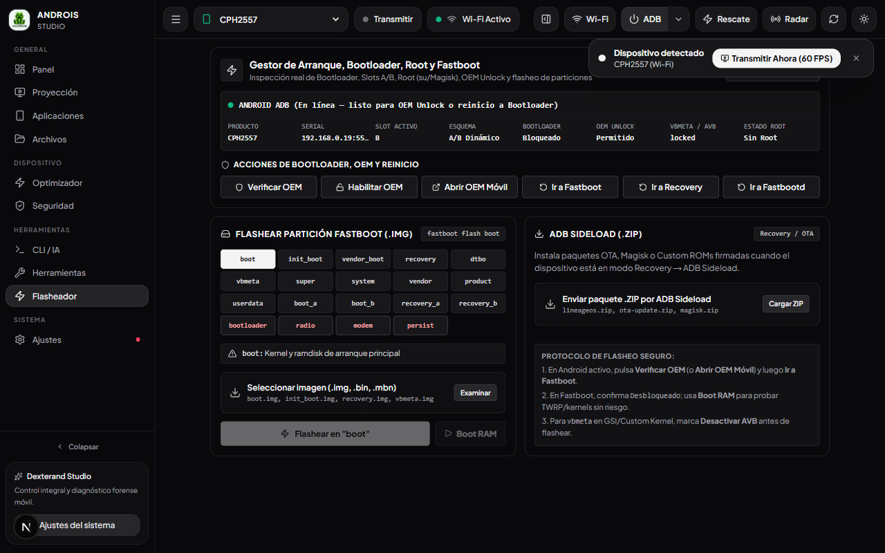
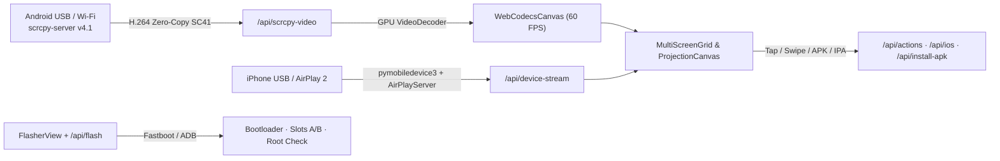

  
  <h1>ANDRO-IOS</h1>
  
<strong>Suite de Proyección 60 FPS, Multi-Pantalla Android/iOS, Telemetría en Vivo, Flasheador Fastboot y Auditoría de Apps</strong>

  

    <a href="./docs/ARCHITECTURE_MAP.md">Mapa de Arquitectura y Funciones</a> ·
    <a href="./INSTRUCCIONES-USO.md">Guía de Uso</a> ·
    <a href="./graphify-out/GRAPH_REPORT.md">Grafo de Conocimiento</a> ·
    <a href="./AndroProject_Installer/README.md">Instalador Windows</a>
  

---

## Demos en Vivo (Reproducción Automática en GitHub)

| Recorrido Completo (Modo Oscuro 2026 + Modo Claro) | Transmisión Real Móvil (`scrcpy 4.1` en Vivo) |
|---|---|
|  |  |
| [Descargar MP4 HD (`androproject-walkthrough.mp4`)](./docs/images/androproject-walkthrough.mp4) | [Descargar MP4 HD (`mobile-transmission-record.mp4`)](./docs/images/mobile-transmission-record.mp4) |

## Modo Oscuro 2026 vs Modo Claro

| Módulo | Modo Oscuro 2026 | Modo Claro |
|---|---|---|
| **Aplicaciones (407 apps)** |  |  |
| **Optimizador & Modo Desarrollador** |  |  |
| **Seguridad & Capturas** |  |  |
| **Herramientas & Drivers USB** |  |  |
| **Flasheador & Bootloader** |  |  |

## Capturas Reales Actualizadas

### 1. Proyección Multi-Pantalla Concurrente (60 FPS WebCodecs H.264)
Transmisión simultánea de **Samsung Galaxy A30s (`SM-A307G`)** y **OPPO A79 5G (`CPH2557`)** lado a lado con decodificación H.264 por GPU y control táctil de baja latencia (`< 2 ms`):

### 2. Panel Principal y Telemetría en Tiempo Real
Lectura directa del kernel Android (CPU, RAM, temperatura térmica, almacenamiento libre) y acceso rápido a las 407 aplicaciones instaladas:

### 3. Gestor de Arranque, Bootloader, Particiones Fastboot y Sideload
Inspección en vivo de estado ADB/Fastboot, Slot A/B activo, OEM Unlock, VBMeta, detección de Root (`su`/Magisk) y flasheo seguro de particiones `.img` / `.zip`:

---

## Mapa de Arquitectura y Flujos

---

## Explicación de Funciones por Módulo

| Módulo | Qué hace | Cómo funciona | Archivo |
|---|---|---|---|
| **Hub Scrcpy 60 FPS** | Administra streams H.264 paralelos por serial | Asigna puerto/SCID único, evita opciones incompatibles con Exynos | [scrcpy-session-hub.ts](./androproject-gui/src/lib/services/scrcpy-session-hub.ts) |
| **Stream Binario Zero-Copy** | Envía frames `SC41` al navegador sin clonar buffers | `ReadableStream` con vista `Uint8Array` sobre `Buffer` y backpressure | [scrcpy-video/route.ts](./androproject-gui/src/app/api/scrcpy-video/route.ts) |
| **Player GPU WebCodecs** | Decodifica H.264 hardware a 60 FPS | Lee `avc1.PPCCLL` del SPS y dibuja en `<canvas desynchronized>` | [webcodecs-h264-player.ts](./androproject-gui/src/lib/services/webcodecs-h264-player.ts) |
| **Visor & Gestos** | Mapea taps, swipes, zoom, wheel y Drag & Drop | Separa matemática, gestos, overlays y carga APK/IPA (`< 200L`) | [ProjectionCanvas.tsx](./androproject-gui/src/components/projection/ProjectionCanvas.tsx) |
| **Multi-Pantalla** | Proyecta todos los dispositivos físicos en paralelo | Deduplica USB vs Wi-Fi y aísla cada panel con `React.memo` | [MultiScreenGrid.tsx](./androproject-gui/src/components/projection/MultiScreenGrid.tsx) |
| **Detección & Stream iOS** | Detecta iPhone USB y sirve frames AirPlay 2 | Consulta `pymobiledevice3 usbmux` + `AirPlayServer.exe` | [ios-usb-detector.ts](./androproject-gui/src/lib/services/ios-usb-detector.ts) · [ios-stream-handler.ts](./androproject-gui/src/lib/services/ios-stream-handler.ts) |
| **Build & Install `.ipa`** | Compila `.ipa` en macOS Cloud e instala por USB | Workflow `macos-latest` + `pymobiledevice3 apps install` | [ios-build.yml](./.github/workflows/ios-build.yml) · [ios-ipa-installer.ts](./androproject-gui/src/lib/services/ios-ipa-installer.ts) |
| **Flasheador & Root** | Inspecciona Bootloader, Slot A/B, OEM, `su`/Magisk y flashea | Ejecuta `adb`/`fastboot`, protege particiones críticas y bloquea seriales iOS | [FlasherView.tsx](./androproject-gui/src/features/FlasherView.tsx) · [flash-device-inspector.ts](./androproject-gui/src/lib/services/flash-device-inspector.ts) |

---

## Documentación Completa

- [Mapa Técnico Detallado](./docs/ARCHITECTURE_MAP.md)
- [Instrucciones de Uso](./INSTRUCCIONES-USO.md)
- [Integración Kali / Termux](./scripts/kali/README-KALI-TERMUX.md)
- [Instalador Oficial Windows](./AndroProject_Installer/README.md)

## Demos en Video (Transmisión Móvil & Suite Dark/Light)

- [Grabación Real de Transmisión Móvil (scrcpy 4.1)](./docs/images/mobile-transmission-record.mp4)
- [Recorrido Completo Modo Oscuro y Modo Claro](./docs/images/androproject-walkthrough.mp4)
