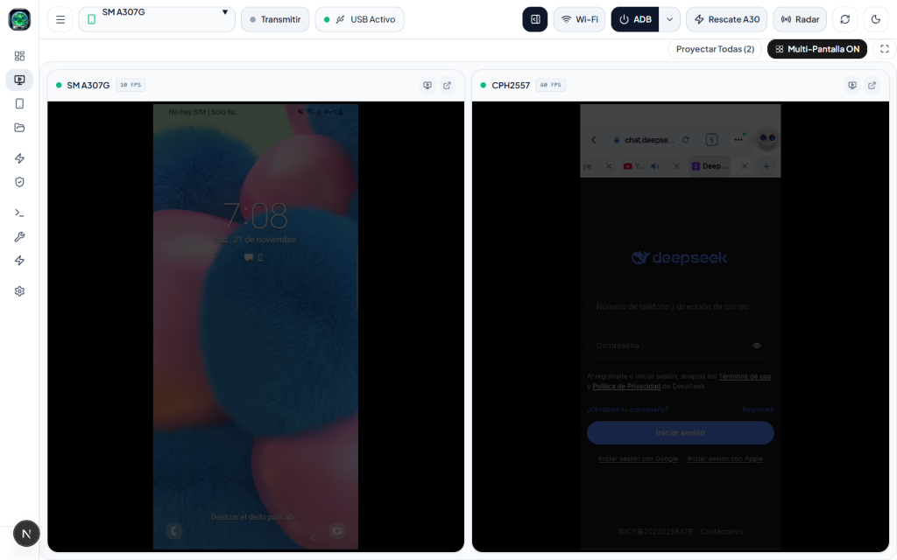
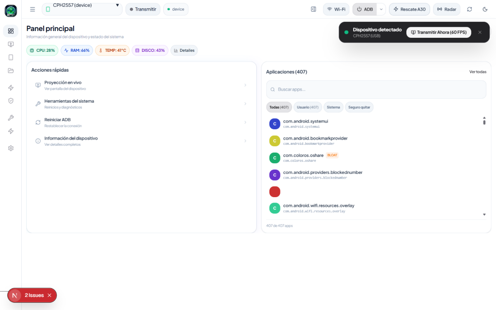
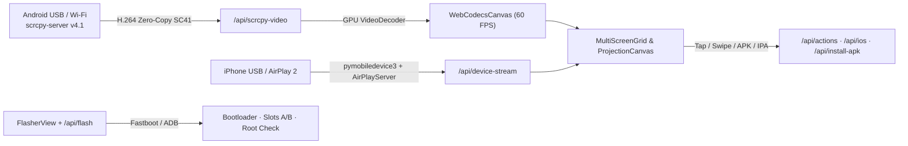

  
  <h1>AndroProject</h1>
  
<strong>Suite de Proyección 60 FPS, Multi-Pantalla Android/iOS, Telemetría en Vivo, Flasheador Fastboot y Auditoría de Apps</strong>

  

    <a href="./docs/ARCHITECTURE_MAP.md">Mapa de Arquitectura</a> ·
    <a href="./INSTRUCCIONES-USO.md">Guía de Uso</a> ·
    <a href="./graphify-out/GRAPH_REPORT.md">Grafo de Conocimiento</a>
  

---

## Capturas Reales de la Interfaz

### 1. Proyección Multi-Pantalla Concurrente (60 FPS WebCodecs H.264)
Transmisión simultánea de **Samsung Galaxy A30s (`SM-A307G`)** y **OPPO A79 5G (`CPH2557`)** lado a lado con control táctil de baja latencia (`< 2 ms`):

### 2. Panel Principal y Telemetría de Sistema
Monitoreo en tiempo real de CPU, RAM, temperatura térmica, almacenamiento y acceso directo a diagnóstico ADB/Fastboot:

---

## Arquitectura del Sistema

---

## Módulos Principales

| Módulo | Función | Rutas clave |
|---|---|---|
| **Proyección & Multi-Pantalla** | Video H.264 60 FPS por GPU, zoom, gestos y vista paralela | [ProjectionView.tsx](./androproject-gui/src/features/ProjectionView.tsx) · [ProjectionCanvas.tsx](./androproject-gui/src/components/projection/ProjectionCanvas.tsx) |
| **Ecosistema iOS (Windows)** | Detección USB (`pymobiledevice3`), AirPlay 2, túnel WDA `8100`, build `.ipa` en la nube | [ios-usb-detector.ts](./androproject-gui/src/lib/services/ios-usb-detector.ts) · [ios-build.yml](./.github/workflows/ios-build.yml) |
| **Flasheador & Root Check** | Inspección de bootloader, slots A/B, OEM unlock, flasheo `.img`, detección `su`/Magisk | [FlasherView.tsx](./androproject-gui/src/features/FlasherView.tsx) · [flash/route.ts](./androproject-gui/src/app/api/flash/route.ts) |
| **Seguridad & Apps** | Detección de apps ocultas, adware con overlay (`HiddenAds`) y debloat sin root | [AppsView.tsx](./androproject-gui/src/features/AppsView.tsx) · [CurarView.tsx](./androproject-gui/src/features/CurarView.tsx) |

---

## Documentación Adicional

- [Mapa Técnico y Flujos Detallados](./docs/ARCHITECTURE_MAP.md)
- [Instrucciones de Uso](./INSTRUCCIONES-USO.md)
- [Integración Kali / Termux](./README-KALI-TERMUX.md)
