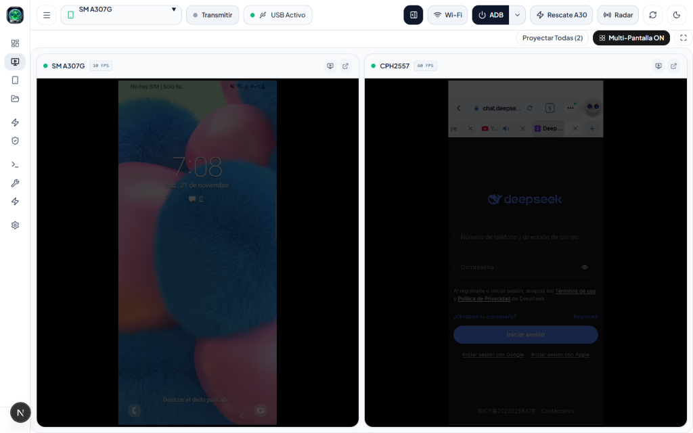
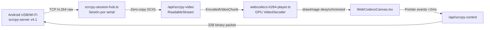
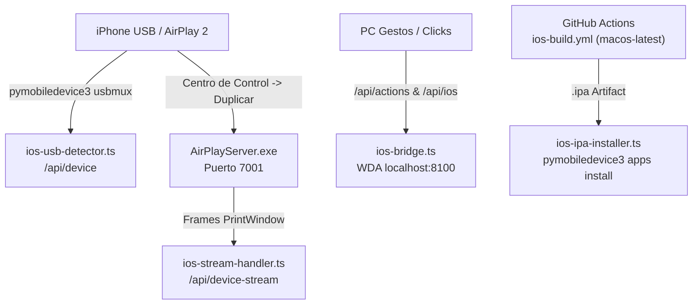

# Mapa de Arquitectura y Flujos — AndroProject

Documentación técnica de los módulos activos, diagramas de flujo de datos y arquitectura modular (`< 200` líneas por archivo, SOLID).

---

## 1. Vista Multi-Pantalla en Vivo (Verificada en Hardware Real)

Transmisión simultánea de **Samsung Galaxy A30s (`SM-A307G`)** + **OPPO A79 5G (`CPH2557`)** a 60 FPS vía WebCodecs H.264:

---

## 2. Mapa de Flujo: Proyección Android 60 FPS + Multi-Pantalla

| Módulo | Qué hace | Cómo funciona |
|---|---|---|
| [scrcpy-session-hub.ts](../androproject-gui/src/lib/services/scrcpy-session-hub.ts) | Gestiona sesiones concurrentes por dispositivo | Lanza `scrcpy-server` sin `video_codec_options` incompatibles con Exynos, asigna puerto/SCID único |
| [scrcpy-video/route.ts](../androproject-gui/src/app/api/scrcpy-video/route.ts) | Entrega stream binario `SC41` al navegador | Vista zero-copy sobre `Buffer` Node.js y guardia de backpressure |
| [webcodecs-h264-player.ts](../androproject-gui/src/lib/services/webcodecs-h264-player.ts) | Decodifica H.264 por GPU en el navegador | Configura `VideoDecoder` con `avc1.PPCCLL` del SPS y `optimizeForLatency: true` |
| [ProjectionCanvas.tsx](../androproject-gui/src/components/projection/ProjectionCanvas.tsx) | Orquesta visor, zoom, gestos y Drag & Drop | Delega a `projection-math.ts`, `useProjectionGestures.ts`, `useProjectionDrop.ts`, `ProjectionOverlays.tsx` |
| [MultiScreenGrid.tsx](../androproject-gui/src/components/projection/MultiScreenGrid.tsx) | Muestra varios móviles en paralelo | Aísla cada tarjeta en `DeviceScreenTile` (`React.memo`) y deduplica USB vs Wi-Fi |

---

## 3. Mapa de Flujo: Ecosistema iOS desde Windows

- **Compilación iOS en la nube:** [ios-build.yml](../.github/workflows/ios-build.yml) compila `WebDriverAgentRunner.ipa` o proyectos Xcode en `macos-latest`.
- **Instalación USB de `.ipa`:** [ios-ipa-installer.ts](../androproject-gui/src/lib/services/ios-ipa-installer.ts) instala paquetes `.ipa` firmados por Drag & Drop desde Windows.

---

## 4. Mapa de Flujo: Root, Bootloader y Seguridad de Apps (Android)

| Módulo | Qué hace | Cómo funciona |
|---|---|---|
| [FlasherView.tsx](../androproject-gui/src/features/FlasherView.tsx) | UI de Bootloader, Slots A/B y Flasheo `.img` | Consulta `/api/flash` (`check_state`) al montar y ejecuta acciones Fastboot/Sideload |
| [flash-device-inspector.ts](../androproject-gui/src/lib/services/flash-device-inspector.ts) | Lee estado real del bootloader y Root | Inspecciona `ro.boot.*`, `fastboot getvar`, slots A/B y detecta `su`/`magisk` |
| [flash/route.ts](../androproject-gui/src/app/api/flash/route.ts) | Backend Fastboot / OEM Unlock / Sideload | Valida particiones permitidas, rechaza seriales iOS y limpia temporales |
| [AppsView.tsx](../androproject-gui/src/features/AppsView.tsx) / [CurarView.tsx](../androproject-gui/src/features/CurarView.tsx) | Detector de apps ocultas, adware y bloatware | Filtra `isHidden`, `hasOverlay` (publicidad sobre pantalla), `isMalware` y `isBloatware` |

---

## 5. Grafo de Conocimiento del Repositorio

El mapa completo de dependencias, comunidades y nodos AST se mantiene actualizado en:
- Reporte: [GRAPH_REPORT.md](../graphify-out/GRAPH_REPORT.md)
- Visualizador interactivo: [graph.html](../graphify-out/graph.html)
